# Admin Guide — Running the Academy Dashboard

**For the academy's staff/owner.** The admin dashboard is where you see bookings, cancel or refund them, block courts for maintenance, change prices and booking hours, and check payments.

> **How to read the pictures:** each screenshot has **red numbered arrows**. Follow them in order — **1 → 2 → 3** — to see what to click or fill in.

**Contents**
1. [Sign in](#step-1--sign-in) · 2. [Overview](#step-2--the-overview-page) · 3. [Find a booking](#step-3--find-a-booking) · 4. [Open a booking](#step-4--open-a-booking) · 5. [Cancel / refund](#step-5--cancel-a-booking-with-or-without-refund) · 6. [Courts](#step-7--courts) · 7. [Booking hours](#step-8--change-the-online-booking-hours) · 8. [Block a court](#step-9--block-a-court-maintenance-events) · 9. [Prices](#step-11--change-prices-and-court-settings) · 10. [Payments](#step-12--payments) · 11. [Account](#step-13--change-your-password) · 12. [Sign out](#step-14--sign-out) · [Admin accounts](#managing-administrators) · [Daily checklist](#daily-checklist) · [Troubleshooting](#troubleshooting)

---

## Step 1 — Sign in

Go to **`your-website/admin/login`**. Type your **email** (arrow 1) and **password** (arrow 2), then click **Sign in** (arrow 3).

- There is no public sign-up. Only administrator accounts can sign in (see [Managing administrators](#managing-administrators)).
- For safety, after too many wrong attempts (6 per account, 20 per network, in 15 minutes) sign-in is paused for a while.

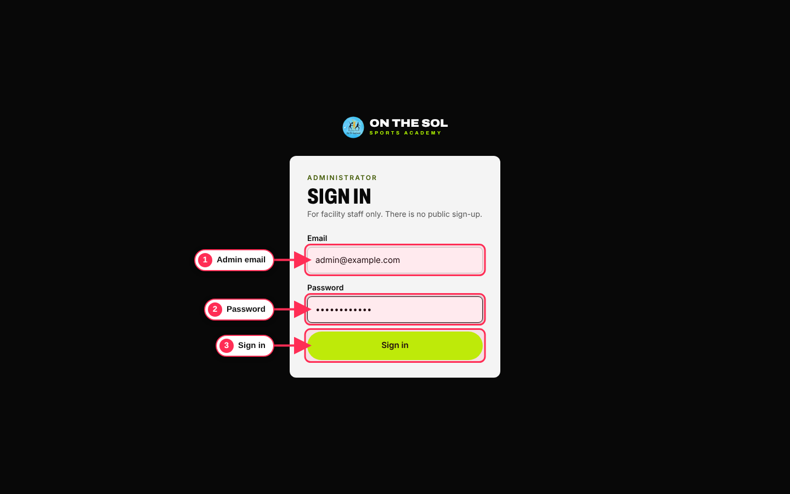

---

## Step 2 — The Overview page

After signing in you land on **Overview**. It is built from live data:

1. **Number cards** (arrow 1): today's bookings, upcoming bookings, confirmed in the last 30 days, **pending payments** (slots currently held by customers who are paying), cancellations, and the amount collected (refunds excluded).
2. **Today on court** (arrow 2): every court by hour. Green = confirmed, cream = payment hold, black = blocked/maintenance, white = free.
3. **Latest bookings** (arrow 3): the newest bookings with their status.
4. **Left menu** (arrow 4): Overview, Bookings, Courts, Payments, Account.

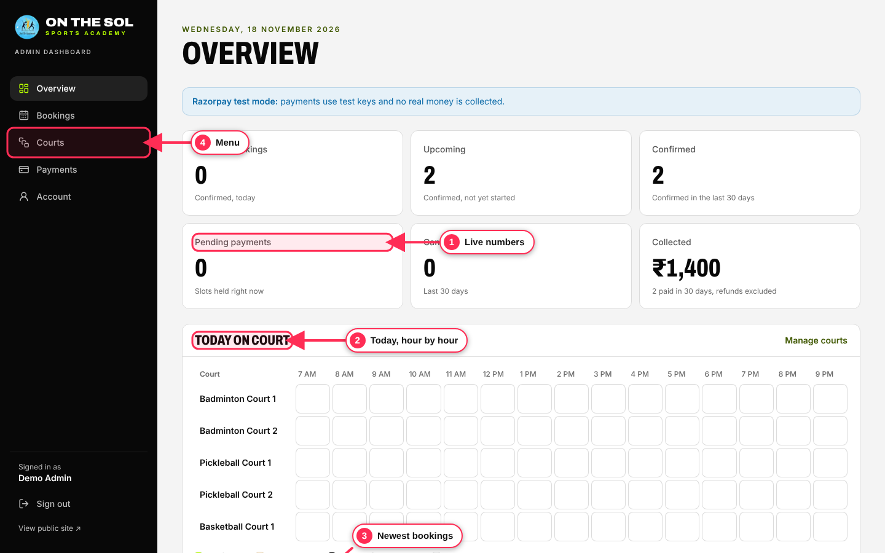

---

## Step 3 — Find a booking

Open **Bookings** in the menu. Search by reference, name, email or phone (arrow 1), narrow by status, sport or dates, and click **Filter** (arrow 2). Click **Clear** to reset. Click a booking's reference (arrow 3) to open it.

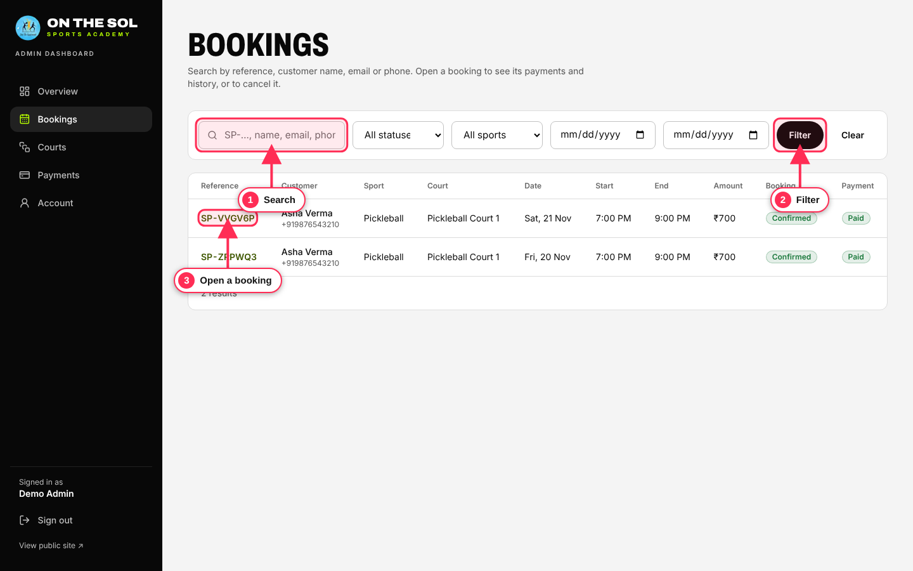

---

## Step 4 — Open a booking

The booking page shows everything about one booking:

1. The **booking reference** and its status badges (arrow 1).
2. **Details**, **Customer** and **Payments** (arrow 2) — including the Razorpay order and payment IDs.
3. **Cancel booking** (arrow 3) — to cancel it, with or without a refund.
4. **History** — every step the booking went through, with times.

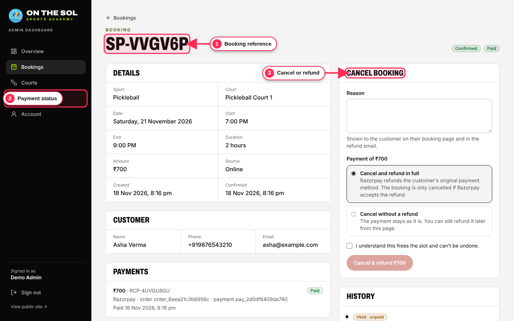

### What the statuses mean

| Status | Meaning |
| --- | --- |
| **Pending / Held · unpaid** | Customer is at checkout; the slot is held for 10 minutes |
| **Awaiting payment** | A Razorpay order was created |
| **Paid** | Payment verified with Razorpay |
| **Confirmed** | Slot is booked — this is the only state that counts as a real booking |
| **Cancelled** | Cancelled by an admin |
| **Refunded** | The payment was returned through Razorpay |
| **Expired** | Not paid in time; the slot was released automatically |

---

## Step 5 — Cancel a booking (with or without refund)

On the booking page, in **Cancel booking**:

1. Type a **Reason** (arrow 1). The customer sees it on their booking page and in the refund email.
2. Choose what happens to the money (arrow 2):
   - **Cancel and refund in full** — Razorpay refunds the customer's original payment method. The booking is only cancelled if Razorpay accepts the refund.
   - **Cancel without a refund** — the payment stays; you can still refund later from the same page.
3. Tick **I understand this frees the slot and can't be undone** (arrow 3).
4. Click the red **Cancel & refund ₹…** button (arrow 4).

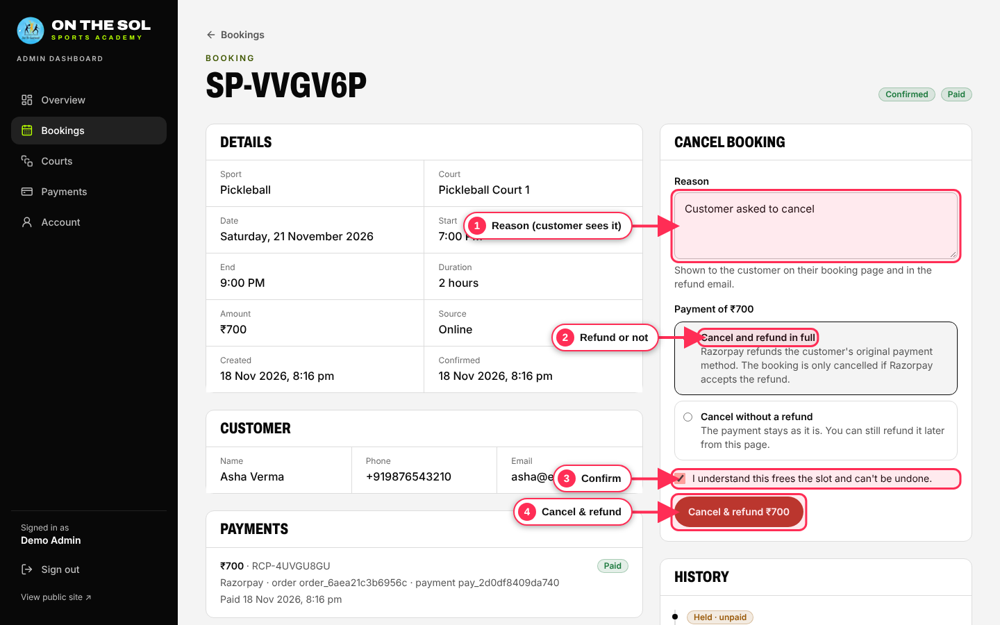

> ⚠️ Cancelling cannot be undone — the slot becomes free for other customers immediately.

---

## Step 6 — Check the result

After cancelling with a refund, the status badges change to **Refunded**, a green message confirms the refund was requested, and **History** records who cancelled it and the Razorpay refund reference. If a refund is still processing you will see **Refund pending**; the page updates when Razorpay reports it processed.

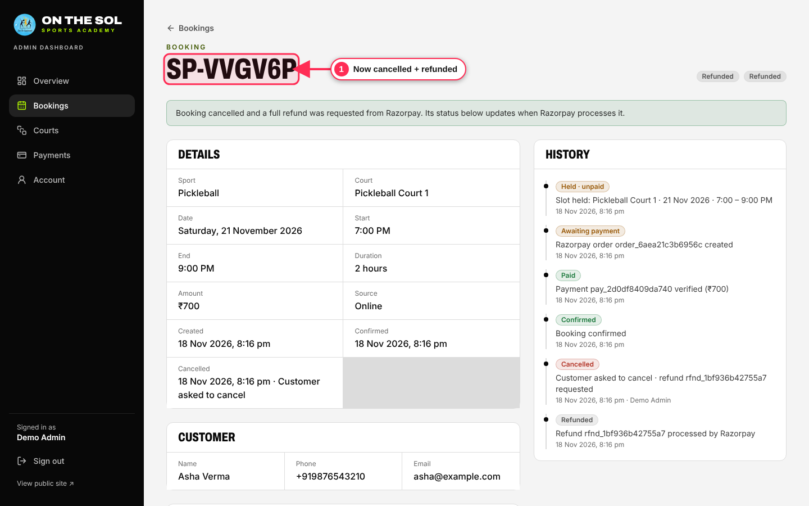

If a booking was cancelled **without** a refund, a **Refund payment** box appears on the same page so you can refund it later.

---

## Step 7 — Courts

Open **Courts** in the menu. Every court is shown with its status and rate card (arrow 1: click one to open it). Below are the **Online booking hours** (arrow 2) and the day schedule for all courts.

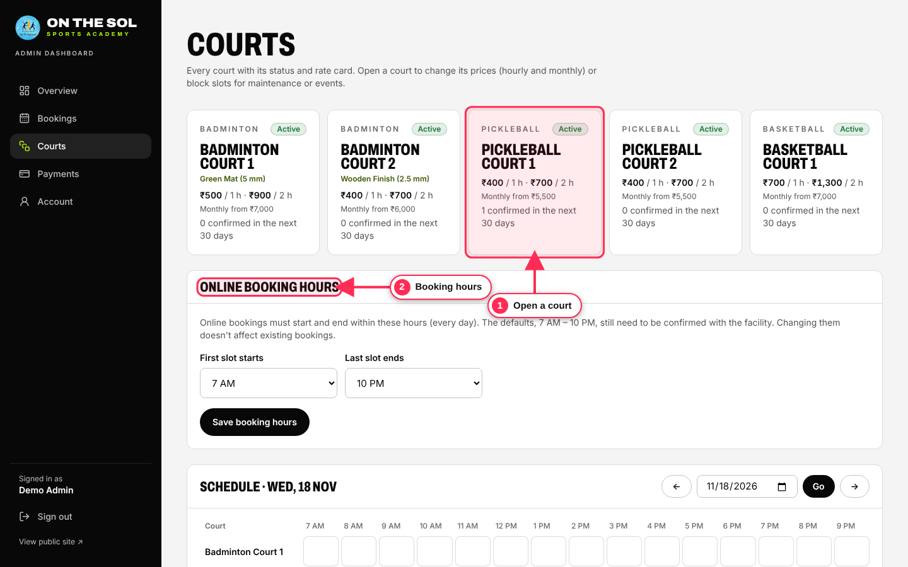

---

## Step 8 — Change the online booking hours

Customers can only book between the first and last slot you set (default **7 AM – 10 PM**).

1. Set **First slot starts** (arrow 1) and **Last slot ends** (arrow 2).
2. Click **Save booking hours** (arrow 3).

Bookings are always 1 or 2 hours on the hour, so the last slot ends at your closing time.

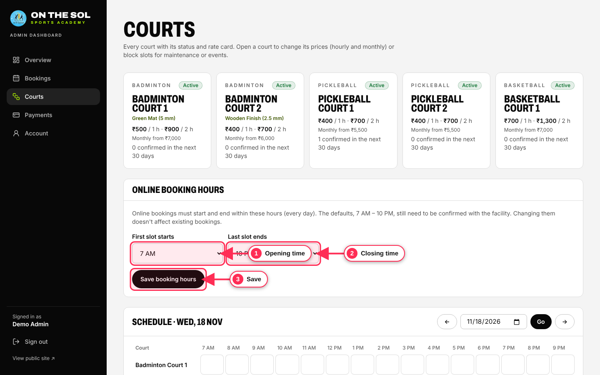

---

## Step 9 — Block a court (maintenance, events)

Open a court (**Courts** → the court). Use **Block slots** to stop customers booking it:

1. **Type** (arrow 1): *Blocked (event, private use)* or *Maintenance*.
2. **Reason** (arrow 2): this is **shown to customers** on the slot.
3. Choose **From date / To date**, then **Whole day** (arrow 3) or a **From / Until** time range.
4. Click **Block court** (arrow 4).

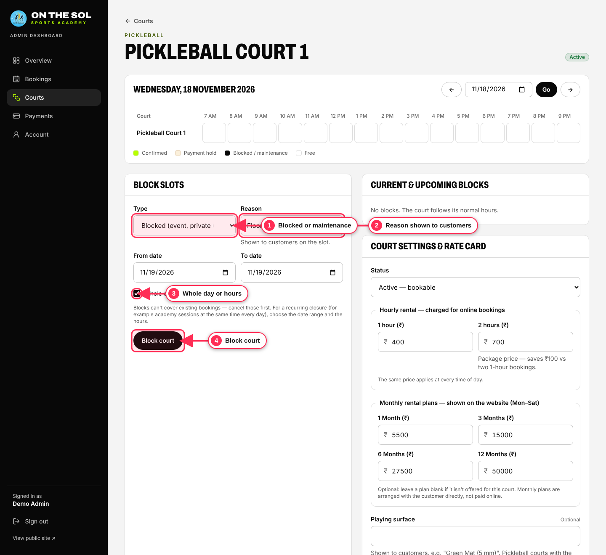

> A block **can't cover an existing booking**. Cancel those bookings first (Step 5). For a recurring closure — for example academy sessions at the same time every day — choose the date range and the hours.

---

## Step 10 — Check or remove a block

The block appears under **Current & upcoming blocks** (arrow 1) and shows as black on the schedule grid. Click **Remove** next to it to free the court again.

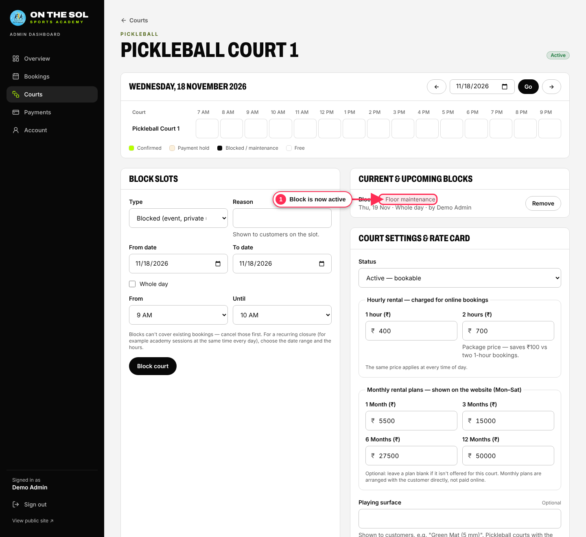

---

## Step 11 — Change prices and court settings

On the same court page, **Court settings & rate card**:

1. **Status** (arrow 1): *Active — bookable*, *Maintenance* or *Inactive*. Only active courts can be booked.
2. **1 hour (₹)** (arrow 2) and **2 hours (₹)** (arrow 3). The 2-hour price is a package price (not twice the hourly price). The same price applies at every time of day.
3. **Monthly plans** (arrow 4): 1, 3, 6 and 12 months. Leave one blank if it isn't offered. Monthly plans appear on the website; customers arrange them with you directly, not online.
4. Optional **Playing surface** and **Description** — shown to customers.
5. Click **Save court** (arrow 5).

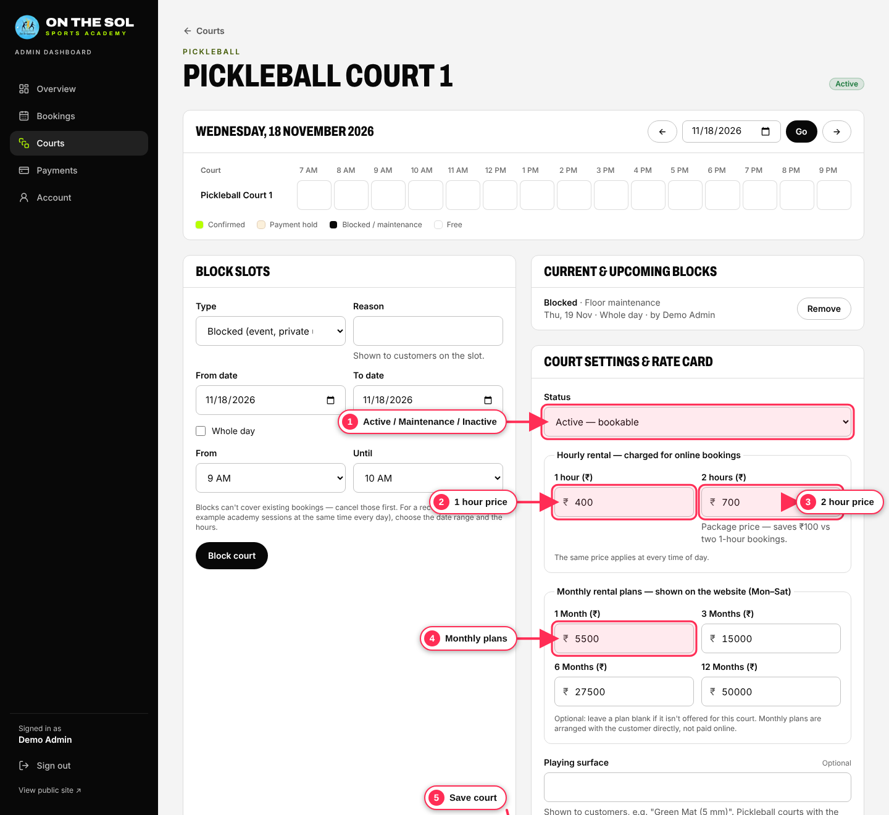

> New prices apply to bookings made **from now on** and appear on the website immediately. Existing bookings keep the price that was paid. Enter prices in whole rupees.

---

## Step 12 — Payments

**Payments** lists every Razorpay payment and refund with its status (arrow 1), so you can reconcile with your Razorpay dashboard.

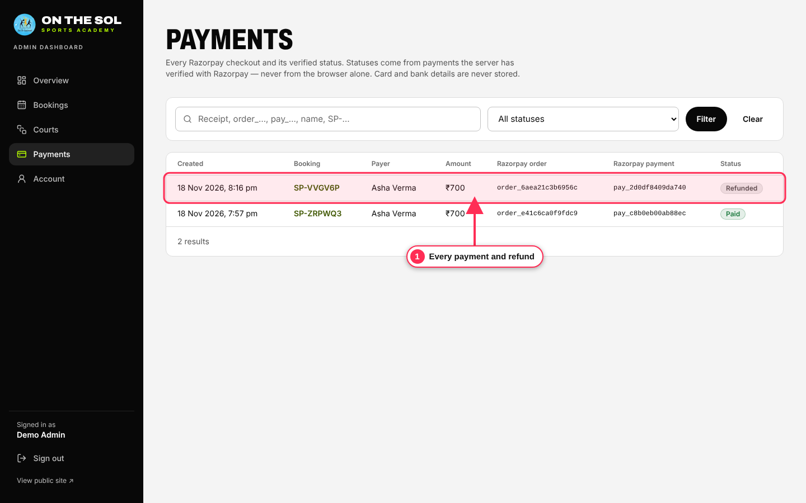

---

## Step 13 — Change your password

**Account** lets you change your password: enter your **current password** (arrow 1) and a **new password** of at least 12 characters (arrow 2), confirm it, and save. Your other signed-in sessions are signed out.

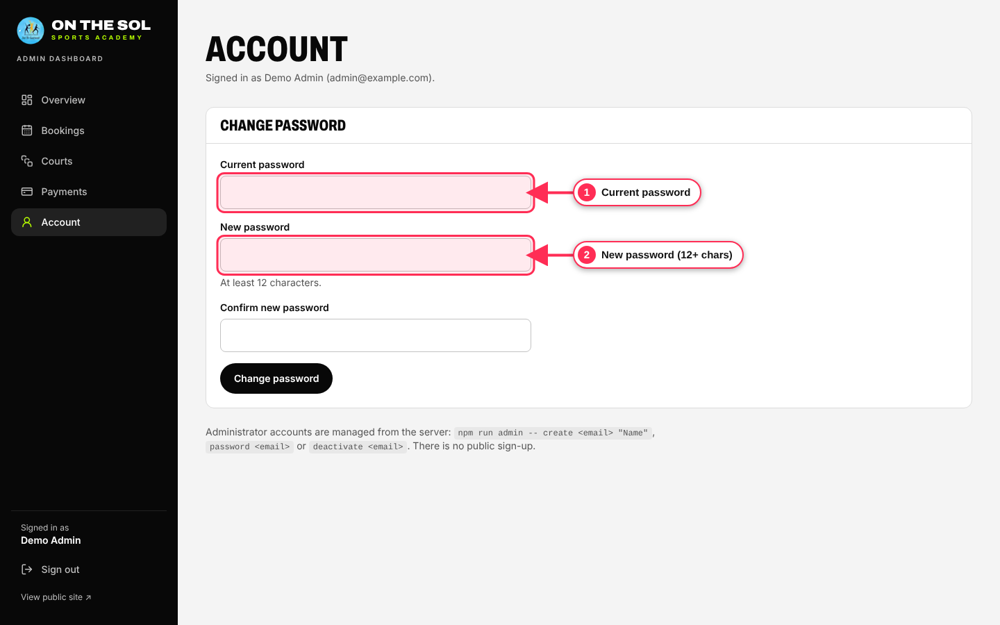

---

## Step 14 — Sign out

Always click **Sign out** (arrow 1) at the bottom of the left menu when you finish, especially on a shared computer.

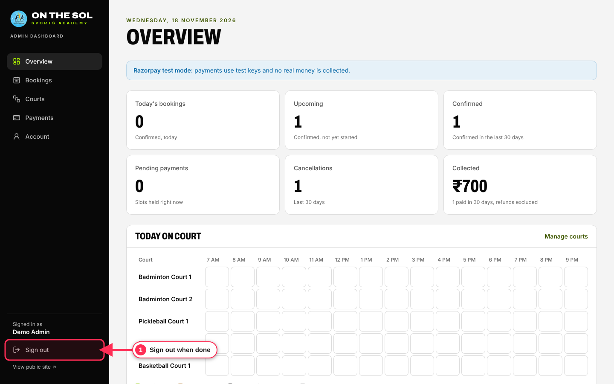

---

## Managing administrators

There are no sign-up pages. The person who runs the server manages admin accounts with a command:

```bash
npm run admin -- create <email> "<name>"   # create an administrator
npm run admin -- password <email>          # set a new password (signs out their sessions)
npm run admin -- deactivate <email>        # block sign-in
npm run admin -- list                      # list administrators
```

---

## Daily checklist

1. Sign in and look at **Overview** — today's bookings and any **pending payments**.
2. Check **Today on court** for anything unexpected.
3. Handle any cancellation requests (Step 5).
4. Block courts for planned maintenance **before** the date (Step 9).
5. Occasionally compare **Payments** with the Razorpay dashboard.
6. **Sign out**.

---

## Troubleshooting

| Problem | What to do |
| --- | --- |
| Can't sign in / "too many attempts" | Wait 15 minutes, or ask the server admin to clear the sign-in rate limit |
| Forgot my password | Ask the server admin to run `npm run admin -- password <email>` |
| A slot shows as held (cream) | A customer is paying; it releases by itself after 10 minutes |
| Customer says they paid but has no confirmation | Open **Bookings**, search their name/phone, and check **Payments** and **History**. The system also confirms payments automatically (webhook and a scheduled check every 30 minutes) |
| Can't block a court | An existing booking overlaps — cancel it first |
| Refund shows **pending** | Razorpay is still processing it; the page updates when Razorpay reports it processed |
| A price change doesn't affect an existing booking | By design — bookings keep the price that was paid |
| Online booking is off on the website | Razorpay keys are missing or wrong in the server settings |
