# User Guide — Booking a Court at On The Sol Sports Academy

**For customers.** No account or sign-up is needed. You choose a court, pay online, and get a confirmation page. The whole thing takes about two minutes.

> **How to read the pictures:** each screenshot has **red numbered arrows**. Follow them in order — **1 → 2 → 3** — to see exactly what to click or fill in.

**Quick path:** Book a Court ➜ Sport ➜ Court ➜ Date ➜ Hours ➜ Time ➜ Your details ➜ Review ➜ Pay ➜ Confirmed ✅

---

## Step 1 — Open the website and start

Open the academy website. At the top you will see the menu. Click **Book a Court** (arrow 1) to go straight to the booking section. Use **Court Rentals** (arrow 2) to see prices first, or tap a sport (arrow 3) to book it directly.

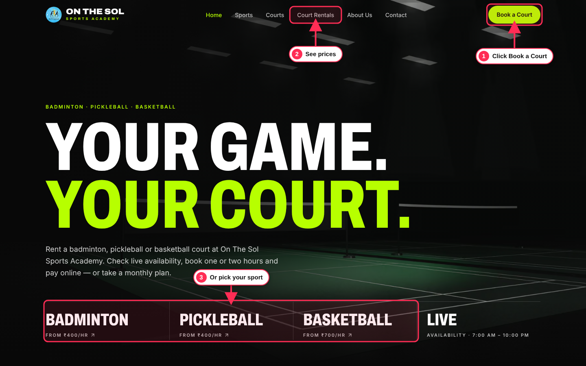

---

## Step 2 — Choose how you want to start (three ways)

You can start booking from any of these places. They all lead to the same booking flow, with your choice already selected.

### A. From a sport
Scroll to **Sports** and click **Book … now** (arrow 1) on the sport you want.

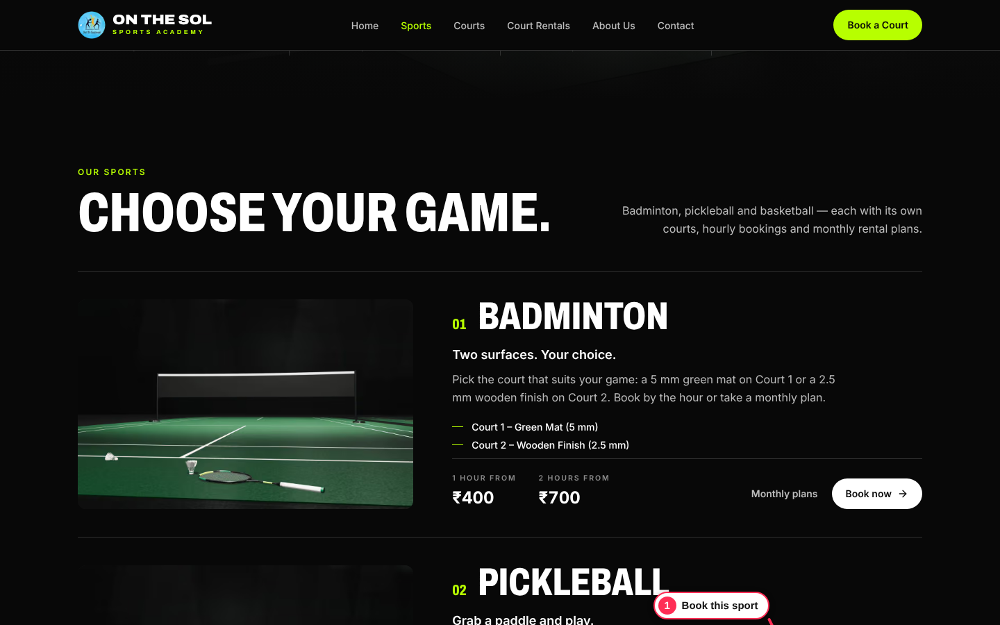

### B. From a court card
Scroll to **Courts**. Each card shows the court, its surface and a live price. Click **Book** (arrow 1) on the exact court you want.

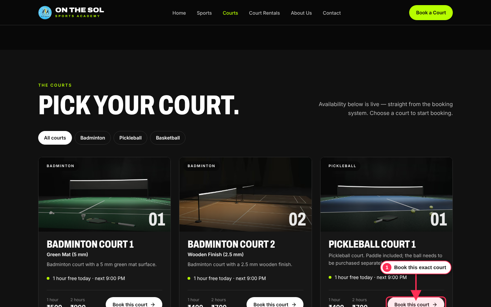

### C. From the price list
**Court Rentals** shows every court's price for **1 hour**, **2 hours** and **monthly plans** (arrow 1). Click **Book …** in a row (arrow 2) to book that court.

- The **2-hour price is a package price** — it is cheaper than booking 1 hour twice.
- The same price applies at every time of day.
- **Monthly plans** (valid Monday–Saturday) are arranged with the academy directly, using the enquiry button. They are not paid online.

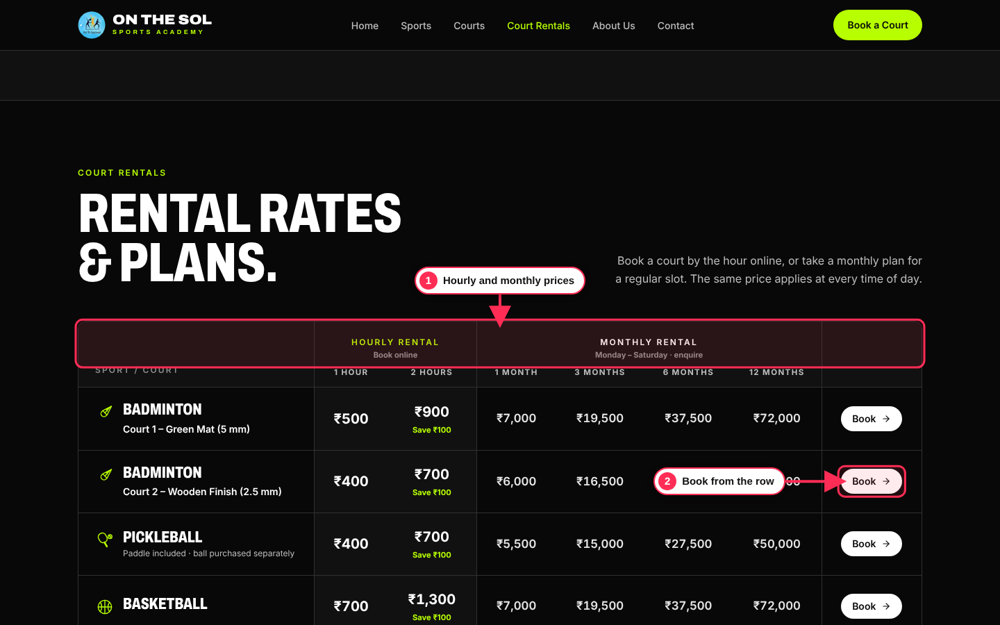

---

## Step 3 — Choose your sport and court

In the booking section, pick your **sport** (arrow 1), then your **court** (arrow 2). Each court shows its surface and price.

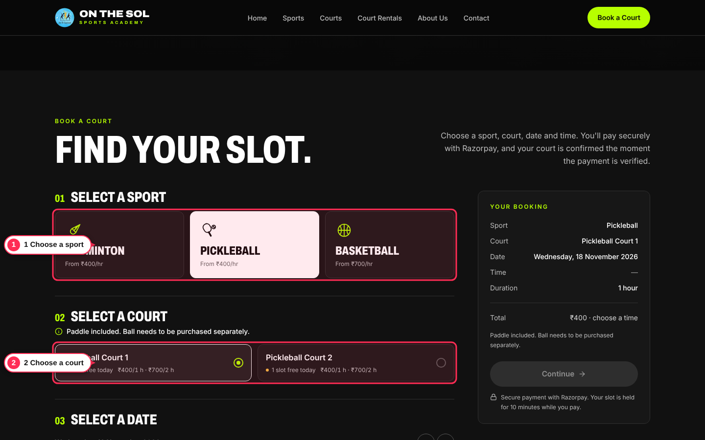

> **Pickleball:** the paddle is included. The ball must be purchased separately.

---

## Step 4 — Pick a date and how long

Click a **date** (arrow 1), then choose **1 hour** or **2 hours** (arrow 2). The price of each option is shown on its button.

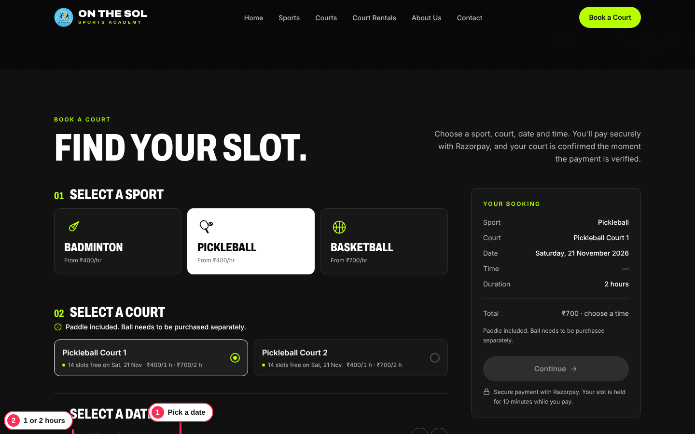

---

## Step 5 — Pick a time slot

Slots are grouped into **Morning**, **Afternoon** and **Evening**. Tap any free slot (arrow 1) — it turns neon green. The **Booking summary** on the right shows your sport, court, date, time and total. When it looks right, click **Continue** (arrow 2).

Slots that are greyed out are already booked, being held by someone paying right now, blocked by the academy, or in the past.

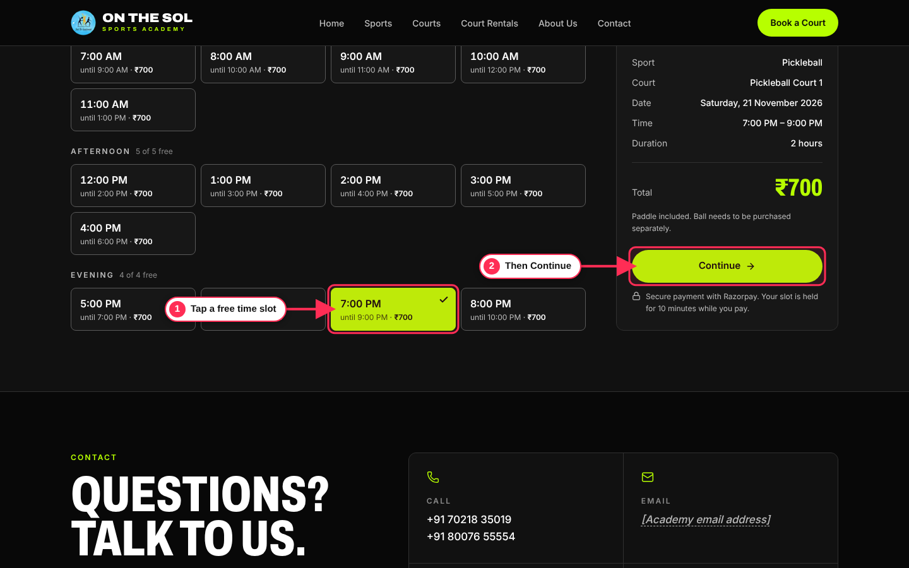

---

## Step 6 — Enter your details

Fill in your **name** (arrow 1), **email** (arrow 2) and **mobile number** (arrow 3), then click **Review booking** (arrow 4).

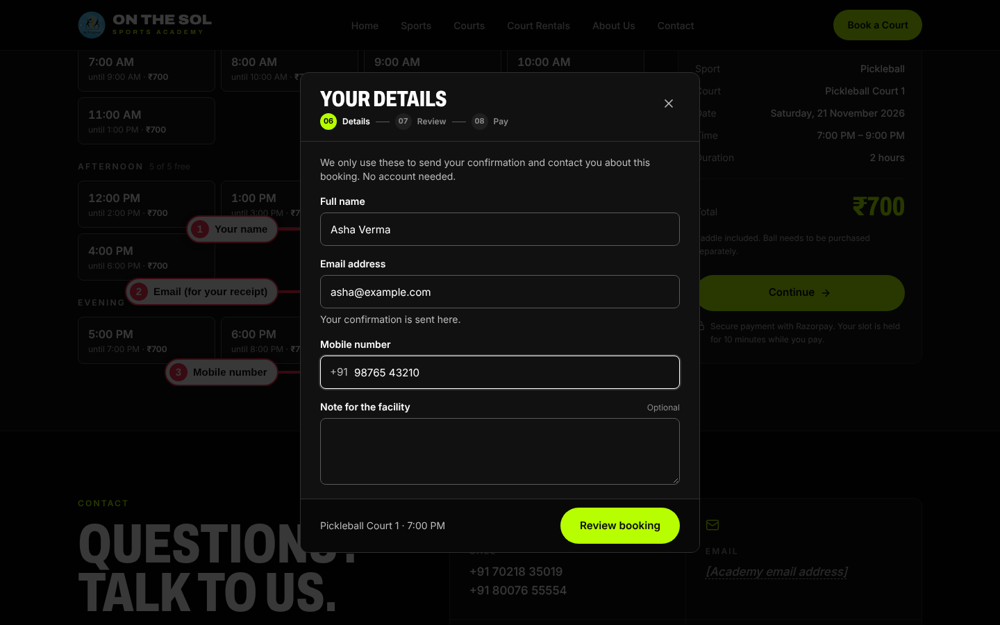

---

## Step 7 — Review and pay

Check the court, date and time (arrow 1). If everything is correct, click **Pay ₹… securely** (arrow 2).

**Your slot is now held for 10 minutes** so nobody else can take it while you pay.

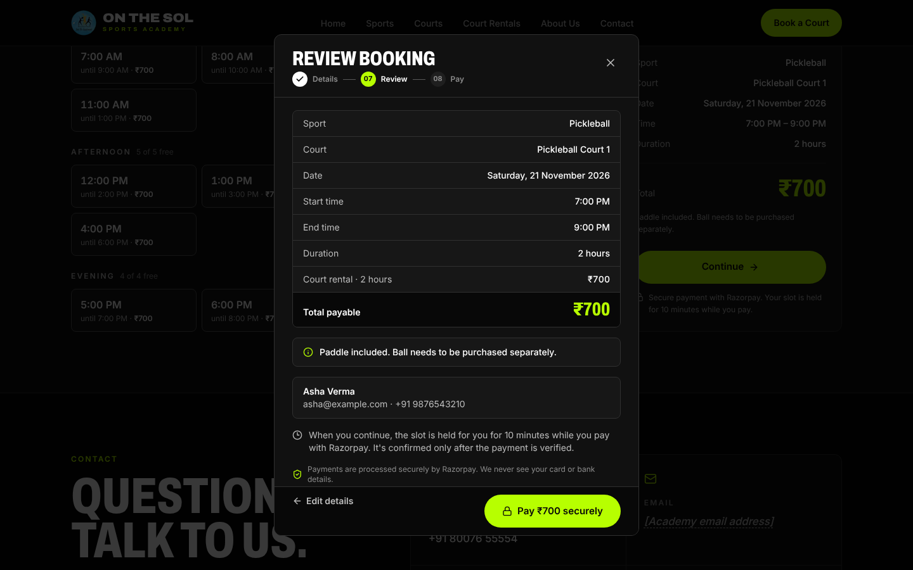

---

## Step 8 — Complete the payment

The secure **Razorpay** payment window opens. Pay with UPI, card or net banking (arrow 1). Do not close the window or press Back until you see the confirmation page.

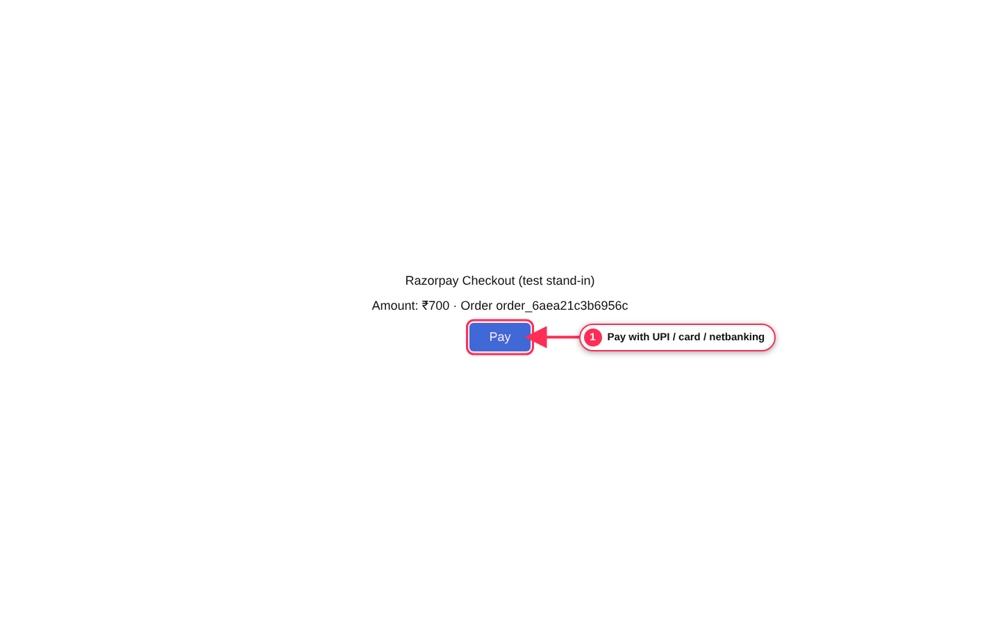

> This screenshot uses a **test stand-in** for Razorpay's window, so no real money was used. On the live site you will see Razorpay's own payment screen.

---

## Step 9 — Booking confirmed ✅

You land on your **confirmation page**. It shows your booking reference (like `SP-ABC123`), court, date and time. From here you can:

1. See that your booking is **confirmed** (arrow 1).
2. **Add to calendar** (arrow 2) to get a reminder on your phone.
3. **Print** the page (arrow 3).

**Save or bookmark this page's link** — it is your private link to your booking. Bring your booking reference when you come to play.

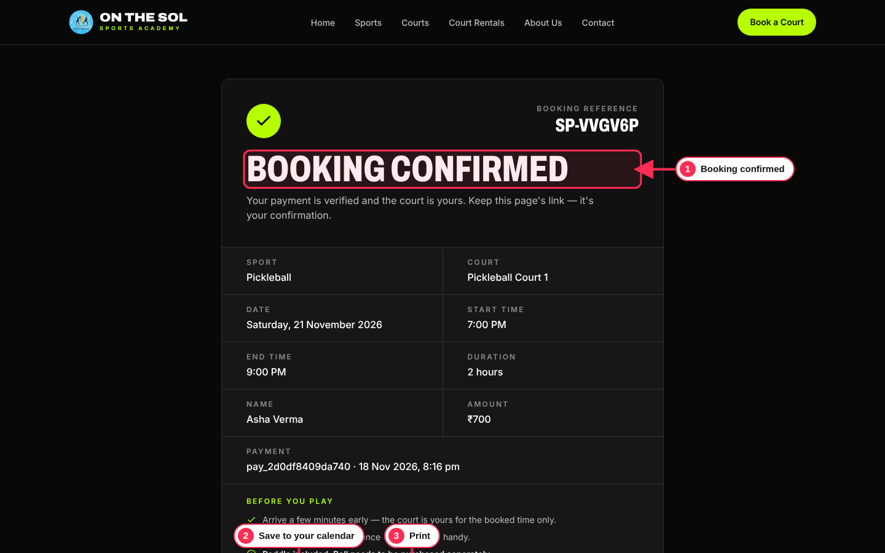

---

## Step 10 — Policies

Before booking, read the **Cancellation & refund policy** (arrow 1). It is linked in the footer of every page, along with the Privacy policy and Terms.

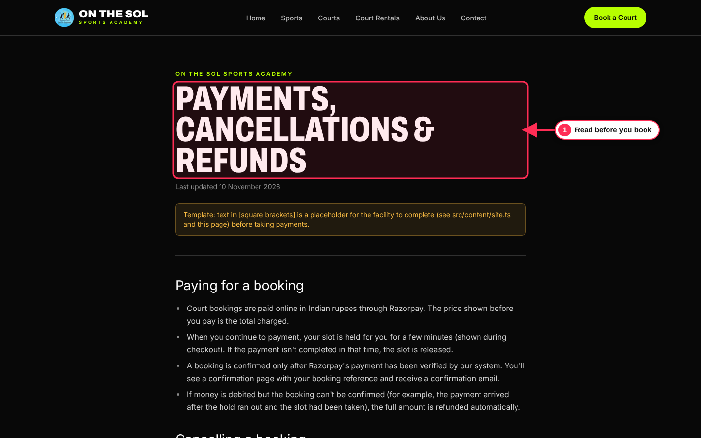

---

## Booking from your phone

Everything works the same on a phone — the layout simply adapts, and the price table becomes cards.

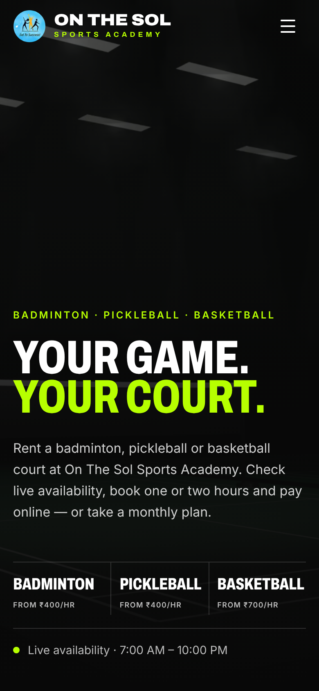
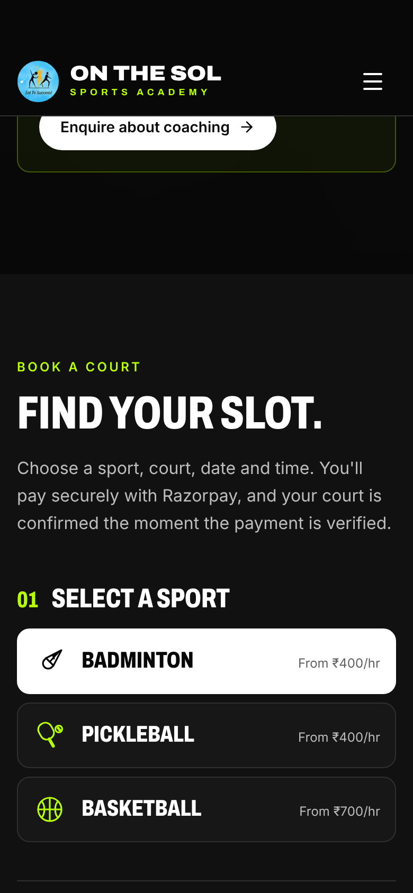

---

## Frequently asked questions

**Do I need an account?** No. Just your name, email and mobile number.

**How long is my slot held?** 10 minutes from when you click **Pay**. If you don't finish paying, the slot is released automatically.

**My payment failed or I closed the window. What now?** If money was not taken, simply start again — pick the slot and pay. If money was taken but you didn't get a confirmation, wait a few minutes and open your booking link; the academy's system also confirms payments automatically in the background. If it still isn't confirmed, contact the academy with your payment details.

**Can I book more than 2 hours?** Online bookings are 1 or 2 hours, on the hour. Make a second booking for another time, or ask about a monthly plan.

**How do I cancel or get a refund?** See the **Cancellation & refund policy**, then contact the academy with your booking reference. Refunds go back to your original payment method.

**How do I get a monthly plan or coaching?** Use the enquiry buttons on the website or call the numbers in the **Contact** section.

**Which sports and courts are available?** Badminton (2 courts, different surfaces), Pickleball (2 courts) and Basketball (1 court). Opening times and live availability are shown on the site.
